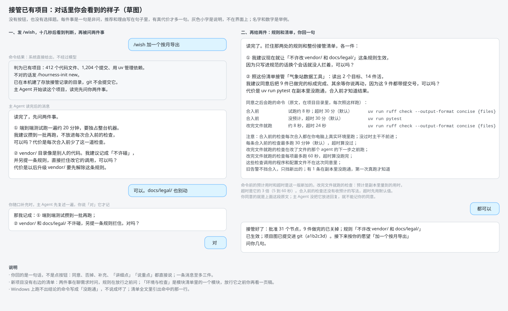

# 接管项目（统一初始化）：给你看的一页（设计 0.6）

## 一次接管（示意）

你做什么：你拿到一个别人留下的 Python 项目，叫「气象站数据工具」，文件夹里还没有项目图。你在对话里发 /wish 加一个按月导出的愿望，回答它的几个问题，最后回「都可以」。

你看到什么：

十几秒后对话里说清它把这里判成已有项目和依据。主 Agent 读完项目，先问两件事，再给一条规则和一份接管清单。清单后面原样列着同意之后会跑的命令，每条旁边是预计用时和超时。整个过程没有按钮，也没有选择题。图里的名字和数字是举例。

## 对你有什么变化

1. 入口只有一个：在没有项目图的文件夹里发 /wish，十几秒后对话里说清它判成新项目还是已有项目、依据是什么；判错了发 /hourness-init new 或 /hourness-init existing 改判。自举完成之前入口多两步：先建一个空的图文件夹，发不带话的 /wish，再发 /hourness-init。
2. 已有项目：主 Agent 先把说明文档、路线和提交记录读一遍，再问你两件事（哪些检查花钱或要独占机器，哪些地方不许碰），读完给你一条拦住「不许碰」之处的规则和一份接管清单。你回两条消息就接管完，随口补充时多回一句「对」。接管只把项目摆上图，还要做的活等你许愿或说「开始」才动。新项目则在聊需求时问这两件事，规则在放行之前问，「环境与检查」是模块清单里的一个模块，放行它之前你再看一页稿。
3. 清单里每条命令旁边写预计用时和超时。你定过的规矩是超时一律取预计的 3 倍。改完文件就跑的检查：预计是副本里量到的用时，超时不低于 5 秒、不高于 60 秒。合入前的检查：另一个设计还没有收预计的写法，超时先按默认的 30 分钟，标「（默认）」，等它收了再照 3 倍。超时只算没跑完或没过，不会让接管崩掉，每次超时都留记录。
4. 主 Agent 从文档里读出来的命令，你同意之前一条都不跑。项目文件里原样写着的命令，会先在系统临时目录的一份副本里试跑：不带你的密码和令牌，推送不出去，每条最多 10 分钟，合计最多 45 分钟，用完即删。副本能上网，也读得到你电脑上的文件；测试若去调外部接口挡不住，事后从日志查，有意读文件再发出去的，副本里拦不住。Windows 上隔离不让被隔离的程序再起子程序，测试命令常在副本里跑不出结论，清单标成「隔离里没跑通」，你同意之后由负责它的检查第一次跑。
5. 主 Agent 读任何文件都不受限，包括登录密钥文件（你定的）；试跑里不带密码令牌，防的是还没同意的项目代码，和它读文件无关。下面的②若答「可以」，读项目时被停掉的命令行每被拦一次，就带规则名记进违规记录，规则页和晨报里看得到；撤下它和撤下任何一条写在代码里的规则是同一条路。

## 要你定的

三件都有我的建议。回「可以」就都按建议定；有不同意的，说是哪一件。

① 接管这个功能自己要做的 7 件活（读项目扫描、入口命令、提醒与草稿、试跑、清单与写入、旧告警只挡新增、点「开始」），各自怎样算做完，我写了 41 条。我建议这样写进项目图，因为逐条念要六千多字，读着累，不合适的地方做到那一件时再改；想看哪一件，说一声，我念给你。可以吗？代价是试跑那件最没把握，Windows 上常跑不出结论，它的几条以后可能要改。

② 读别人的项目时，我建议先停掉主 Agent 的命令行和网页抓取（你定过它可以用命令行，这是收回其中一小段），因为项目文档里可能写着骗它把数据发出去的话；读文件和搜索照常，你同意接管之后立刻恢复。可以吗？代价是读项目的这十几分钟，只有命令查得到的事它得来问你；嫌碍事就对它说一句话撤下，撤下后这个项目不再拦，直到你恢复。

③ 接管来的待做活，我建议开工前不用先看一页放行稿，你说「开始」就派，因为这些活是从项目文件里读出的现状，不是你放行过的设计，每个里程碑各写一页，一次接管就几十页。可以吗？代价是里程碑很大时，不看就开工可能做偏；你若要看就回「要」，但这要先改另一个设计、自举之后才办，在那之前也按不看做。

## 替你定的方向

替你定了 57 个方向，每个都能推翻，列在 design.md 第 17 节（55 个）和第 0.1 节（另 2 个）；其中 4 个是编排方的裁定。
