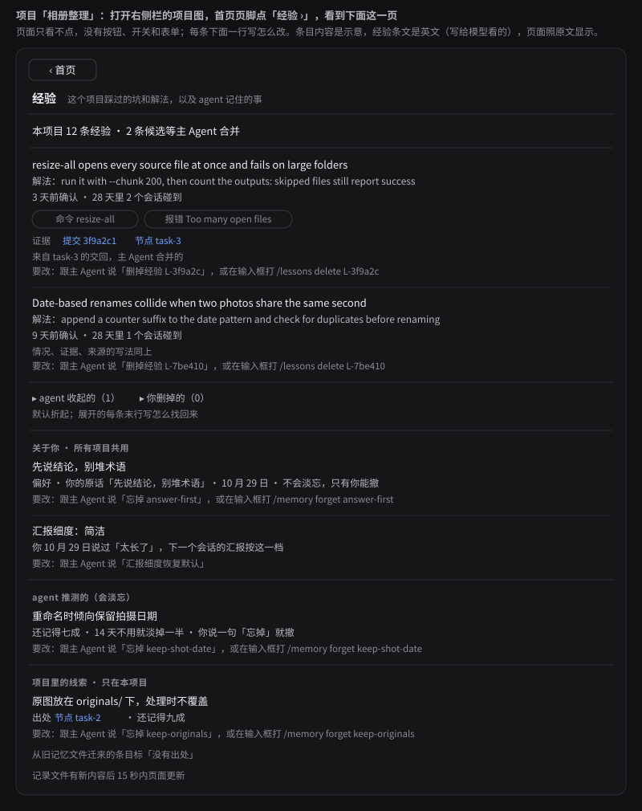

# 记忆与经验：给你看的一页（设计 0.6）

## 你会看到什么

你在「相册整理」里让主 Agent 批量缩图。一个子 agent 的缩图命令报「打开文件太多」，它改成分批跑才过，交回时附上这个坑，主 Agent 把它合并成一条经验。过几天另一个子 agent 的同一条命令报同样的错，它的下一次请求里多了一条提醒，写着上次的解法：分批跑，并数一数输出。

你只需要想看时看一眼：打开右侧栏的项目图，首页页脚点「经验 ›」，就是下面这一页。上半是这个项目踩过的坑和解法，下半是 agent 记住的关于你和项目的事。页面只看不点，要删哪条，对主 Agent 说一句，每条下面一行写着怎么说。

## 对你有什么变化

1. 项目图首页页脚多一个「经验 ›」，经验和记忆都没装上时不显示。要删或找回一条，跟主 Agent 说一句；你删掉的经验不再提醒 agent。
2. 记忆按项目分开存。关于你本人的偏好（例如「先说结论，别堆术语」）所有项目共用，带你的原话，不会淡忘，只有你能撤。agent 自己猜的习惯和项目里的事实，14 天不用就淡掉一半，你说一句「忘掉这条」就删。项目事实必须写出处，写不出就存不进。
3. 每个会话开局，主 Agent 的第一次请求带一份记忆索引；子 agent 没有记忆，也看不到索引。给 GLM 的记忆那段提示词从约 880 字符改成约 2,210 字符，每个请求多约 1,300 字符。
4. 经验只是建议，不拦任何动作；要拦走规则板，由你批。派活时简报带至多 5 条相关经验；命令失败、报错对得上某条经验时，下一次请求带提醒，至多 2 条。同一条经验 28 天内在 3 个会话里碰到，主 Agent 收到一次提醒，由它判断要不要来问你定成规则，你同意才生效。
5. 系统从你的纠正里学：你改过的字段、否决的提议、对方案说的「不行」、重开已做完的事。同一类出现 2 次，主 Agent 每七天至多收到一次提醒，把它落到偏好、推测、经验、规则提议或练习题之一，只有规则提议会来问你。你说「以后都说重点」，下一个会话的汇报就按这一档。

## 要你定的

① 九件活怎样算做完，以及放不放行

背景：记忆与经验拆成**九件活**，条件写在 onepage-done.md。

推荐：你**逐条看过、改完**，再放行开工。

疑问：最没把握的是**推测的习惯**，14 天不用就淡忘。

不做：不把九张单子**直接写进项目图**。

九件的条件你看完再定，这份设计可以放行开工吗？

## 替你定了的方向

另有 38 件小事替你定了，每件都能推翻：37 件列在 design.md 第 11 节，1 件（记忆里还存不存项目事实）在第 12 节末尾。

## 现状

0.5 评审第 5 轮通过。0.6 只按你 10 月 31 日定的「规则直接拦」改了第一批经验里的一条；你同日定的另外两件（密钥文件能读、超时由实测定）碰不到这一块。经验这个新插件先关着，桌面版上分两批验证，第一批验过才默认打开；验证直接用桌面版，不另行通知你。这块不在自举必经的路上；它依赖的 split 已经合入，你放行后就可以开工。
