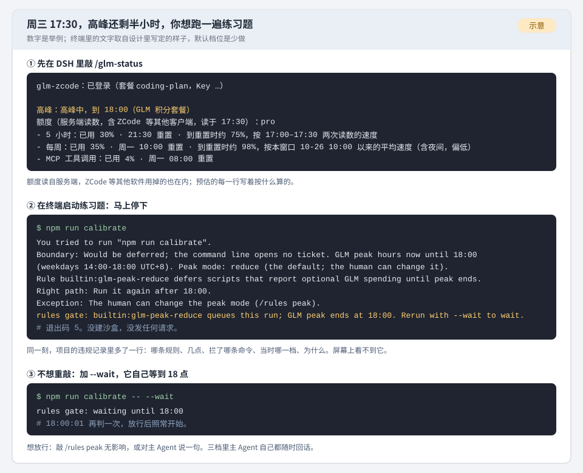

# M6 用量与高峰：给你看的一页（设计 0.7）

## 一个下午（示意）

你做什么：周三 17:30，高峰还剩半小时。你想跑一遍练习题（系统自己跑的固定小项目，用来查改动有没有改坏东西）。你先在 DSH 里敲 /glm-status 看额度，再在终端里启动练习题，最后加上 --wait 再启动一次。

你看到什么：

状态页写着正在高峰、到 18:00，5 小时额度已用 30%，照现在的速度到重置时约 75%。练习题一启动就停下，什么都没开始，写明 18 点以后再跑。加了 --wait，它自己等到 18 点再接着跑。图里的数字是举例。图里第 2、3 块要等规则板整块上线才会出现，第 1 块随 M6 就有。

## 对你有什么变化

1. 额度看得见：敲 /glm-status 或 /hourness，看到 5 小时额度和每周额度各用了多少、几点重置、照现在的速度到重置时大约用到多少，预估的每一行写着按什么算的。数字读自服务端，ZCode 等其他软件用掉的也在内。你敲命令时读一次，等额度最多 3 秒，来不及就先给上一次的读数；装了循环板之后，GLM 在用时由循环板至多每 15 分钟读一次，没人用就不读；没有循环板时，只在你敲命令那一刻读。
2. 用量按积分算：/hourness 的用量一节改成积分，和面板同一个算法。数字只含经 DSH 发出的请求，会写明；10 月 29 日删掉的 806 条旧记录单独占一行，看得出那段缺了数。
3. 高峰提醒按档位说话：高峰是工作日 14 点到 18 点（北京时间）。无影响，提醒和今天一字不差。少做（默认），同时至多开 1 个 GLM 子 agent，练习题、对照实验、大的审查这类能挪的重活留到 18 点以后。不做，不派 GLM 子 agent，也不起花 GLM 积分的脚本。三档里主 Agent 都随时回你话，它自己的工具调用也不排队。改档位敲 /rules peak 加档名，或对主 Agent 说一句，它提给你确认。
4. 练习题直接拦，拦下有记录：按你说的「试运行规则啥的直接拦就行了，这样反而有问题好发现」，默认的少做档里，练习题和对照实验在高峰启动前就停下，真账号核对（改了连接 GLM 的代码后，拿真账号跑一次，确认还连得上）照跑。选不做，真账号核对也停；选无影响，都照跑。每次拦下或排队，项目的违规记录多一行：哪条规则、几点、拦了哪条命令、当时哪一档、为什么。想放行，对主 Agent 说一句，或敲 /rules peak 无影响。这些拦截和排队，包括子 agent 的上限，要等规则板整块上线才生效，在那之前只有提醒按档位说话，脚本照常开始。晨报和规则页上的次数，要等另外两个模块接上才数得到；在那之前，每次拦截都在违规记录里留了一行。
5. 快用完、登录失效会告诉你：5 小时或每周额度用到 80%，或照现在的速度一小时内会用完，主 Agent 在下一次回话里说一句，每个额度周期只说一次。GLM 登录被服务端拒绝时，它让你运行 /glm-login；主 Agent 自己跑在 GLM 上时回不了话，你会在 DSH 里直接看到请求失败。循环板上多四条来自 GLM 包的条目，只能看，不能改，也不能关。这两句提醒和这四条条目，要等循环板的实现接上才有；在那之前，登录被拒会写在 /glm-status 的第一行。

## 你定了的

11 月 1 日你对下面两件答「都按你说的来就行」，都照建议定了，想改随时说。

① 少做档里，已经派出去的 GLM 子 agent 把手上的活做完再停。停在半截，已经做的部分会白费。要不要挪，由主 Agent 在派活之前定。代价是大的审查派出去之后，会占着高峰的额度做完。

② 改了连接 GLM 的代码后的真账号核对，在少做档的高峰里照跑，只有不做档才停。核对跑完，改动才能并进主线。代价是高峰按全价扣积分，跑一次要调用几十次。不做档停下它这一半，同第 4 条，要等规则板整块上线。

## 替你定的方向

替你定了 32 个方向，每个都能推翻：28 个列在 design.md 第 19 节，另外 4 条是编排方对几份设计之间怎么分工的裁定，列在第 0.1 节表里「编排方的接缝裁定」那一行。
