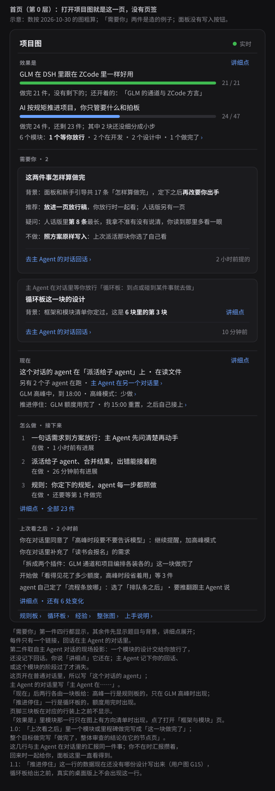

# 面板说人话与新手引导：给你看的一页（设计 1.3，评审已通过）

## 你打开面板，会看到什么

你在右侧栏打开「项目图」，看到的是这一页：

最上面是每个目标做完几件、还剩几件，例如「做完 24 件，还剩 23 件」。接着是「需要你 · 2」：第一件是一道题，题目下面背景、推荐、疑问、不做各一行，没有选项，也没有批准、拒绝按钮，只有一行「去主 Agent 的对话回话 ›」。你点它，跳到主 Agent 的对话，用自己的话回「可以」或「不行，因为……」；它记下之后，这一件从面板上消失。这四行是旧问法：你 10 月 31 日定了新问法，主 Agent 那一块正按它改，面板之后跟着换。再往下是现在谁在做什么、接下来的三件、上次看之后变了什么。

## 对你有什么变化

1. 面板只给你看，没有会改东西的按钮。要停一件事、改规则、改高峰档位，都跟主 Agent 说一句，或在输入框打命令，例如 /rules peak 不做。你说过「档位当然能选」，这一条最可能不合你意。
2. 项目按两层循环走时，首页目标下多一行「6 个模块：1 个等你放行 · 2 个在开发 · 2 个设计中 · 1 个做完了」，点开是「框架与模块」页（mockup-modules.svg）。等你放行的模块进「需要你」；放行之后新提的模块这时批不了，只在这一页单列一行，等下次定框架。这个仓库的图上还没有方向清单，所以暂时看不到这一行。
3. 首页页脚能进规则板和循环板（mockup-boards.svg），插件带来的条目只能看。写在代码里的规则一启用就拦，每条写最近 7 天拦下几次，下面一行写怎样撤下，今天撤不了的写原因。你定的、带脚本的条目写脚本在哪、点开是原文、是不是你同意的那一版；改过一个字就不跑，要你在对话里再同意一次。
4. 带超时的条目，超时是「跑一次要多久」的 3 倍：先用写脚本的 agent 估的，跑过之后用最近几次里最慢的一次，不低于下限、不高于上限；没估的先取上限或设计里定的数。旁边写这个数从哪来，估的和实测的点开能看它每次怎么变、超时过几次。主 Agent 可以调高一项的上限，页上写调到几秒、哪天、为什么，你说一句就改回。
5. 额度用完、推进停住时，首页「现在」里多一行，写约几点重置、之后自己接上；一块做完、整个目标做完，「上次看之后」各单列一行。第一次打开面板有上手说明（mockup-onboarding.svg），点「去首页」就跳过；GLM 另有三步上手：登录、选模型、发一句话。

「推进停住」那一行和几块板上超时的数据要别的模块配合，已在 design.md 第 11 节写成给它们的请求，等自举之后办；配合好之前，那一行不会出现，第 4 条里估的和实测的超时也看不到。

## 替你定了的

另有 56 件能撤回的事替你定了，列在 design.md 第 12 节，每件都能推翻。

## 要你定的

① 这两件事怎样算做完

面板和新手引导一共 17 条「怎样算做完」，写在 design.md 第 1.4 节，人话版在同目录的 onepage-done.md。这些条还没写进项目图，你没签过任何一版；按分工，「怎样算做完」只能由你定。

我建议你放行这一页时，对着人话版把这 17 条一起定下，想改哪条直接说「第几条改成……」，因为人话版已经写好，不用为它单独再来一轮，可以吗？代价：定下之后，再改这 17 条要你出手；其中第 6、9 条写的是旧问法的四行，面板换成新问法时要再请你改一次。
