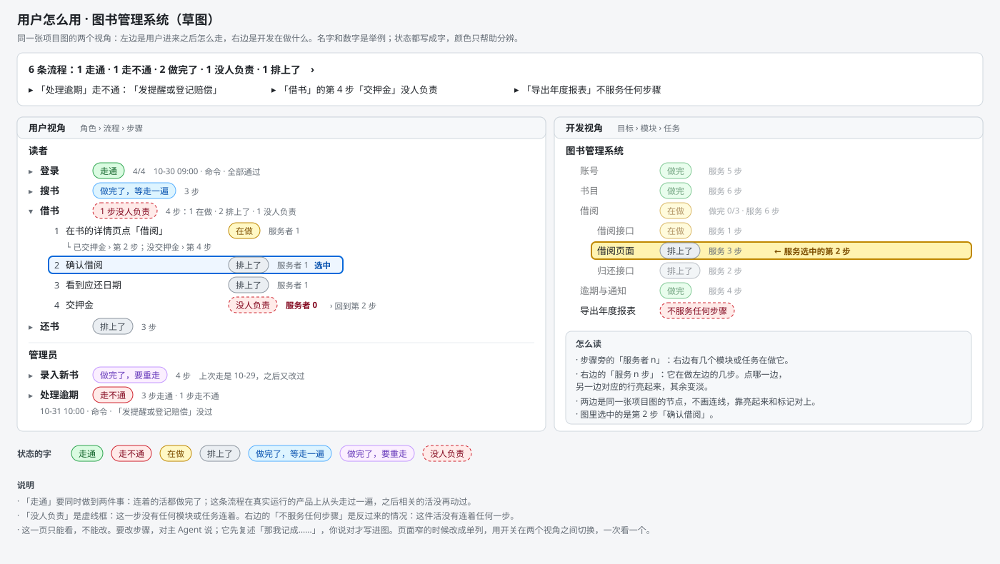

# 项目用户图：给你看的一页（设计 0.4.1）

## 一个图书馆项目（示意）

你做什么：你用这个插件给社区图书馆做借还书系统。访谈时主 Agent 先猜：「我猜用它的有读者和管理员，读者登录、搜书、借书、还书，管理员录入新书、处理逾期，对吗？」你说对，放行，开发开始。几天后你想起一件事，对主 Agent 说「借书前要先交押金」，它复述「那我记成：借书加一步交押金」，你说对，它在图里加了这一步。之后你打开面板的「用户怎么用」页。

你看到什么：

左边是用户怎么用：每个角色有几条流程，每条流程有几步，每步旁边写着状态。右边是开发在做什么：模块和任务。两边是同一张项目图。图里「登录」走通了，「处理逾期」有一步走不通。「借书」里新加的「交押金」没人负责，右边的「导出年度报表」不服务任何步骤，两处都标了出来。选中左边的「确认借阅」，右边服务它的「借阅页面」亮起来。

「走通」的意思是：连着的活都做完了，而且这条流程在真实运行的产品上从头走过一遍，之后相关的活没再动过。

## 对你有什么变化

1. 访谈多一问。主 Agent 先猜谁会用、进来先做什么，你来改。结果画成角色、流程、步骤，用你的话写，每一步还写一句怎样算做成。确认需求时你会看到这份草稿，问你哪里不对。已经走完访谈的项目不受影响。
2. 面板多一页「用户怎么用」，首页「效果是」先写流程进度，再写做完几件。没人负责的步骤和不服务任何步骤的活，两边都标出来。你在对话里一步步改的时候不拦，只在放行、走一遍之前、做完这三处拦。页面只能看，要改对主 Agent 说。
3. 放行时多看到三样：每条流程由哪个模块负责，每个模块服务哪几步，每条流程将怎样走一遍（命令原文和超时）。这些不齐就放不过去：每一步要有人负责，每条流程要写好怎么走一遍。你同意的是这几段内容。别的模块这期间推进了，你的同意照样有效；步骤、负责的模块或命令原文变了才作废，会重新给你看。
4. 目标做完之前，系统把每条流程在真实运行的产品上走一遍，留下记录。能自动测的它自己跑，跑的就是你放行时看到的命令；界面类的每步截图，由另一个 Agent 对照「怎样算做成」看图。主 Agent 不能自己报通过。有两处还没验证：模型能否可靠地看图判断（不行就去掉截图这一种，那些流程改用命令、终端或请你自己走）；测试本身写错了，系统只靠审查把关，可能漏过，所以「走通」说明测试通过了，不等于没有毛病。没法自动测的流程，请你亲自走一遍，它会告诉你走的是哪个提交。
5. 放行以后改步骤、顺序或「怎样算做成」，仍要你的话：主 Agent 先复述「那我记成：……」，你说对才写。谁来做哪一步这类开发的账，它自己记，下一批用一句话告诉你。加一步若要动已放行模块的设计，就退回那个模块，让你重看一页；要新模块，回到定模块清单。晨报按流程说进度。

## 要你定的

三件，都带着我的建议。回「可以」就是都照建议，不同意的说是哪一件。

① 我建议每个新项目的访谈都画一遍「用户怎么用」（没有终端用户的写一句原因就跳过），因为选填的话没人会画，这个功能就用不上，可以吗？代价是每个新项目的访谈多一轮。

② 画了用户图的项目，怎样才算做完？

- 只提醒：目标照样做完，晨报里标出没走通的流程。
- 每条流程走通才算做完（推荐）：没走通的流程让目标停在最后一步，晨报点名；没法自动测的流程要请你亲自走。

③ 我建议照这一页放行这份设计，因为五轮独立评审里挡路的问题从 12 条降到 0 条（12、4、2、2、0；最后一轮另有 5 条不挡放行的低风险意见），可以吗？代价是用户图画进项目以后，旧版本的插件读不了这张图，新旧版本不能混用同一张项目图。

告知：实现排在 M3（访谈与放行）和 M7（派活与执行）的骨架合入之后，这是你之前定过的。

## 替你定的方向

替你定了 27 个方向，每个都能推翻，列在本特性 design.md 的第 12 节；该节共 29 条，另外 2 条就是上面的①和②。
