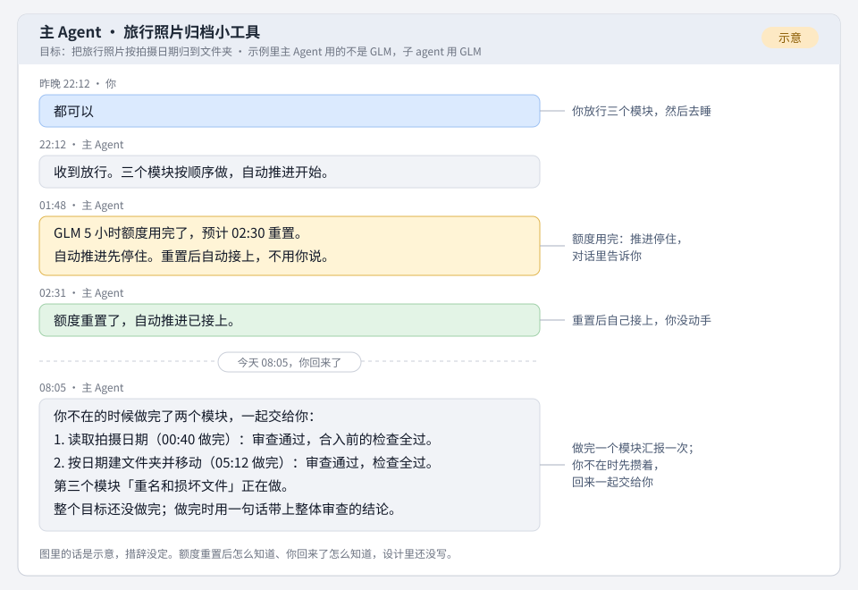

# 用户图 0.6：给你看的一页

## 一个晚上（示意）

你做什么：框架下午已放行。晚上 22:12，你读完主 Agent 一次交来的三个模块放行方案（读取拍摄日期、按日期建文件夹并移动、重名和损坏文件），回一句「都可以」，然后去睡。第二天 08:05 回来，打开对话。

你看到什么：

夜里 01:48 额度用完，推进停住，对话里有一条告诉你。02:31 额度重置，推进自己接上，你没动手。做完的两个模块，汇报先攒着，08:05 你一回来就一起交到手里。图里的话是示意，措辞没定，示例里的主 Agent 用的是别的模型。

## 对你有什么变化

- **额度用完**：自动推进停住，对话里告诉你；额度重置后自己接上，不等你开口。这是你定的。
- **做完一点汇报一点**：分了模块的目标，每个模块做完就汇报一次；你不在时先攒着，你回来一起交给你；整个目标做完时，一句话带上整体审查的结论。这是你定的，读法你也确认过。
- **规则一启用就拦**：写在代码里的规则不设试运行期，这是你定的。每次拦下，按规则编号记在规则页和晨报里，拦错了看得出来。撤下只有一条路：对主 Agent 说一句话，或打一条命令（编排方定的，你可以推翻）。
- **密钥文件 agent 可以读**：不设读密钥的规则，也不记谁读了。密钥不能进日志和提交，这条检查照旧。这是你定的。
- **超时有依据**：写脚本或检查的 agent 先估跑一次要几秒，超时是这个估计的 3 倍；跑过之后，估计换成最近几次里最慢的一次，超时仍是它的 3 倍。你批准时看到超时和它依据的估计。超时不崩，每次都留痕。超时取估计的 3 倍、不取估计本身，是编排方定的，你可以推翻。

## 要你定的

① 放行用户图 0.6

背景：用户图是装上后十个阶段的用法总图，按你 10 月 31 日的话改了 **5 处**，评审已通过

推荐：**放行**。定稿后作为项目文档，本项目先自己试用，再到真实项目里按它逐格走。

疑问：最没把握的是**主 Agent 自己跑在 GLM 上**时，额度用完谁来告诉你。

不做：不为这几处现在改**已放行的设计**，等本项目试用之后再办。

放行用户图 0.6，可以吗？

## 替你定的方向

编排方替你定了 **11** 个方向，列在用户图设计稿第 6.2 节，你可以推翻。
